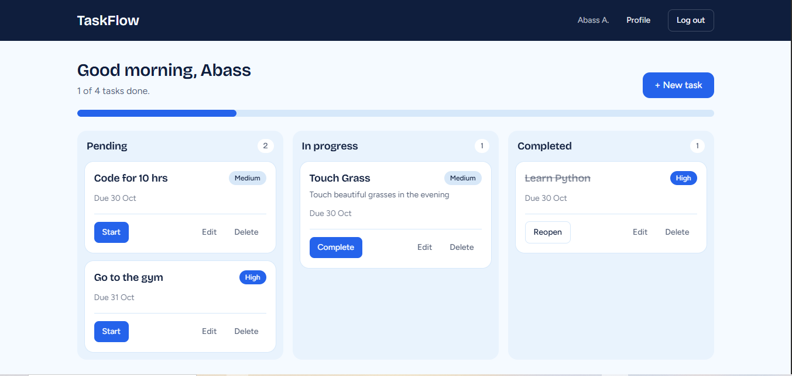
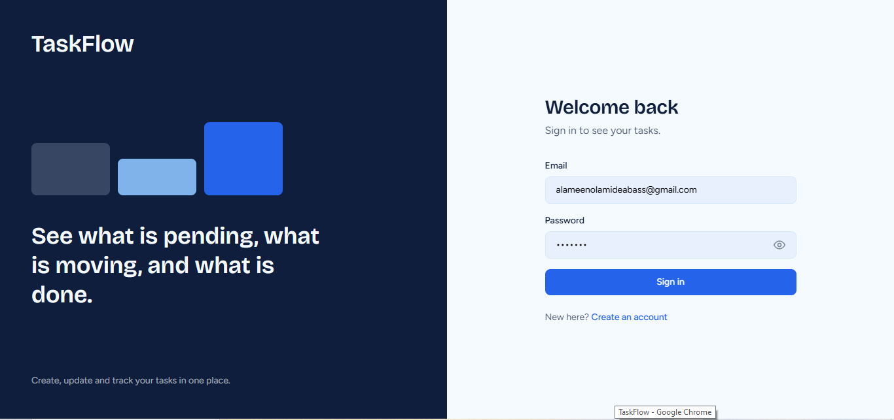
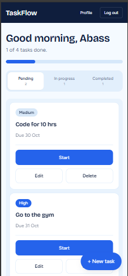

<h1 align="center">TaskFlow</h1>

<p align="center">
  A full-stack task management app built with the MERN stack.<br />
  Create, update, delete and track your tasks from one clean dashboard.
</p>

<p align="center">
  <a href="https://taskflow-vit.vercel.app"><strong>Live Demo</strong></a> ·
  <a href="#api-reference">API Reference</a> ·
  <a href="#getting-started">Getting Started</a>
</p>

<p align="center">
  
  
  
  
  
  
</p>

---

## Overview

TaskFlow is a task management application where every user has a private account and a personal board of tasks. Tasks move through three stages (**Pending → In Progress → Completed**), so you can always see what is waiting, what you are working on, and what is done.

It was built as a full-stack project covering the whole flow: a React frontend, a REST API with Express, and a MongoDB database, with JWT-based authentication tying them together.

**Live app:** https://taskflow-vit.vercel.app

## Screenshots

> Replace these with your own images. Put the files in a `docs/screenshots/` folder in the repo.

| Dashboard | Login |
| :---: | :---: |
|  |  |

| Mobile |
| :---: |
|  | 

## Features

- **Task management:** create, edit, delete and track tasks
- **Status tracking:** tasks are grouped into Pending, In Progress and Completed, with a progress overview
- **Priority levels:** mark tasks as low, medium or high priority
- **User accounts:** register and log in securely with JWT authentication
- **Private data:** every user only sees and edits their own tasks
- **Profile page:** update your display name
- **Change password:** update your password after confirming the current one
- **Show/hide password:** eye toggle on every password field
- **Responsive design:** works on phones, tablets and desktops
- **Secure by default:** passwords are hashed with bcrypt and task routes are protected by middleware

## Tech Stack

| Layer | Technology | Purpose |
| --- | --- | --- |
| Database | MongoDB Atlas | Stores users and tasks |
| Backend | Node.js, Express | REST API |
| ODM | Mongoose | Schemas and database queries |
| Frontend | React (Vite) | User interface |
| Styling | Tailwind CSS | Utility-first styling with a custom theme |
| Routing | React Router | Client-side pages |
| HTTP client | Axios | Calls the API and attaches the auth token |
| Auth | JSON Web Tokens, bcryptjs | Login sessions and password hashing |
| Hosting | Vercel | Deployment |

## How It Works

```
React (Axios)  →  Express route  →  Controller  →  Mongoose  →  MongoDB
      ↑                                                            |
      └────────────────────── JSON response ←──────────────────────┘
```

1. A user registers or logs in and the server returns a signed JWT.
2. The client stores the token and Axios sends it in the `Authorization: Bearer <token>` header on every request.
3. The `protect` middleware verifies the token and attaches the user to the request before any task route runs.
4. If the server reports an invalid or expired token, the client logs the user out automatically.

## Project Structure

```
taskflow-mern/
├── client/                     # React frontend (Vite)
│   └── src/
│       ├── api/
│       │   └── axios.js        # Axios instance + token interceptor
│       ├── components/         # Navbar, Field, AuthLayout, ProtectedRoute, task components
│       ├── context/
│       │   └── AuthContext.jsx # Logged-in user state and auth actions
│       ├── pages/              # Login, Register, Dashboard, Profile
│       ├── App.jsx             # Routes
│       ├── main.jsx
│       └── index.css           # Theme colors and base styles
│
└── server/                     # Express API
    ├── config/
    │   └── db.js               # MongoDB connection
    ├── controllers/
    │   ├── authController.js   # Register, login, profile, change password
    │   └── taskController.js   # Task CRUD logic
    ├── middleware/
    │   └── authMiddleware.js   # JWT verification (protect)
    ├── models/
    │   ├── User.js
    │   └── Task.js
    ├── routes/
    │   ├── authRoutes.js
    │   └── taskRoutes.js
    └── server.js               # Entry point
```

## Getting Started

### Prerequisites

- [Node.js](https://nodejs.org/) v18 or newer
- npm (comes with Node.js)
- A free [MongoDB Atlas](https://www.mongodb.com/atlas) account (or a local MongoDB installation)
- [Git](https://git-scm.com/)

### 1. Clone the repository

```bash
git clone https://github.com/YOUR_USERNAME/taskflow-mern.git
cd taskflow-mern
```

### 2. Set up the backend

```bash
cd server
npm install
```

Create a file named `.env` inside the `server` folder:

```env
PORT=5000
MONGO_URI=mongodb+srv://<username>:<password>@<cluster>.mongodb.net/taskflow?retryWrites=true&w=majority
JWT_SECRET=replace_with_a_long_random_string
```

**Getting a MongoDB connection string**

1. Create a free **M0 cluster** on MongoDB Atlas.
2. Under **Database Access**, create a database user with a password.
3. Under **Network Access**, allow your IP address (or `0.0.0.0/0` for development only).
4. Click **Connect → Drivers**, copy the connection string, insert your password, and add `/taskflow` before the `?` so the database has a name.

Start the API:

```bash
npm run dev
```

You should see:

```
Server running on port 5000
MongoDB connected: ...
```

### 3. Set up the frontend

Open a second terminal:

```bash
cd client
npm install
```

Create a file named `.env` inside the `client` folder:

```env
VITE_API_URL=http://localhost:5000/api
```

Start the app:

```bash
npm run dev
```

Open **http://localhost:5173** in your browser, create an account, and start adding tasks.

## Environment Variables

| Variable | Where | Description |
| --- | --- | --- |
| `PORT` | `server/.env` | Port the API listens on (default `5000`) |
| `MONGO_URI` | `server/.env` | MongoDB connection string |
| `JWT_SECRET` | `server/.env` | Secret used to sign JSON Web Tokens |
| `VITE_API_URL` | `client/.env` | Base URL of the API, including `/api` |

> Never commit `.env` files. They are already covered by the Node `.gitignore`.

## API Reference

Base URL: `http://localhost:5000/api`

All routes marked 🔒 require the header `Authorization: Bearer <token>`.

### Auth

| Method | Endpoint | Auth | Description |
| --- | --- | :---: | --- |
| `POST` | `/auth/register` | | Create an account |
| `POST` | `/auth/login` | | Log in and receive a token |
| `PUT` | `/auth/profile` | 🔒 | Update the user's name |
| `PUT` | `/auth/password` | 🔒 | Change password (needs current password) |

### Tasks

| Method | Endpoint | Auth | Description |
| --- | --- | :---: | --- |
| `GET` | `/tasks` | 🔒 | Get all tasks for the logged-in user |
| `POST` | `/tasks` | 🔒 | Create a task |
| `PUT` | `/tasks/:id` | 🔒 | Update a task (including its status) |
| `DELETE` | `/tasks/:id` | 🔒 | Delete a task |

### Task model

| Field | Type | Notes |
| --- | --- | --- |
| `title` | String | Required |
| `description` | String | Optional |
| `status` | String | `pending`, `in-progress` or `completed` (default `pending`) |
| `priority` | String | `low`, `medium` or `high` (default `medium`) |
| `dueDate` | Date | Optional |
| `user` | ObjectId | Owner of the task, set automatically |

### Example request

```http
POST /api/tasks
Content-Type: application/json
Authorization: Bearer <token>

{
  "title": "Finish the README",
  "priority": "high"
}
```

```json
{
  "_id": "665f1c2e8a1b2c3d4e5f6a7b",
  "title": "Finish the README",
  "description": "",
  "status": "pending",
  "priority": "high",
  "user": "665f1b0a8a1b2c3d4e5f6a70",
  "createdAt": "2026-10-29T10:00:00.000Z",
  "updatedAt": "2026-10-29T10:00:00.000Z"
}
```

## Design

TaskFlow uses a custom **Sky Blue** theme, defined once as Tailwind theme tokens in `client/src/index.css`.

| Token | Hex | Used for |
| --- | --- | --- |
| `mist` | `#F5FAFF` | Page background |
| `frost` | `#D6E8FA` | Borders, surfaces, inactive elements |
| `sky` | `#7FB3EA` | Accents, focus rings, "In Progress" |
| `royal` | `#2563EB` | Primary buttons, links, active states |
| `navy` | `#0F1E3D` | Text and navbar |

## Deployment

- **Frontend:** deployed on [Vercel](https://vercel.com). Set `VITE_API_URL` in the project's environment variables to your deployed API URL (ending in `/api`).
- **Backend:** deploy the `server` folder to a Node host such as [Render](https://render.com). Set `MONGO_URI` and `JWT_SECRET` as environment variables, use `npm install` as the build command and `node server.js` as the start command.
- **Database:** MongoDB Atlas. Allow your host's outbound IPs in **Network Access**.

## Future Improvements

- Forgot password and email reset flow
- Task search and filtering by priority or due date
- Drag and drop between status columns
- Due date reminders
- Unit and integration tests

## Author

**YOUR NAME**

- GitHub: [@YOUR_USERNAME](https://github.com/IbnAbass1401)
- LinkedIn: [your-profile](www.linkedin.com/in/abass1401)

## License

This project is licensed under the MIT License.